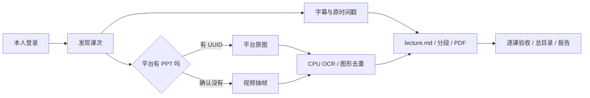

# 同济课程采集系统 · Tongji Course Collector

[](https://github.com/flywuyu/tongji-course-collector/actions/workflows/tests.yml)
[](LICENSE)

把**自己有权访问的同济课程回放**整理成可以复习、搜索和交给 AI 阅读的本地资料：时间戳字幕、PPT 原图、OCR、PDF 和图文 `lecture.md`。

这是学生维护的非官方工具，首版 **v0.1.0 / Windows 10、11 + NVIDIA CUDA**。每位使用者用自己的账号登录；仓库只发布程序和合成示例，不提供账号、课程直链或课堂内容。

## 能做什么

- 登录后发现本人课程回放，保持课程、周次、日期和节次的命名稳定。
- 本地 large-v3 转写，保留原视频时间；每课一个进程，结束释放资源。
- 深度 1 音频预取；逐块保存进度，解码超时后只重试问题块一次。
- **有平台 PPT UUID → 下载平台图片；确认没有 → 从视频抽帧**。网络错误不算“没有 PPT”。
- OCR 与图形共同去重，保留图形变化；按时间合并字幕、PPT 和 OCR。
- 生成完整讲义、每 10 分钟阅读段、图片 PDF，以及按课程/周次整理的总目录。
- 周五 **00:00–08:00** 主运行，周六 **00:00–08:00** 补跑；窗口内恢复失败任务，08:00 停止并保存断点。
- 高温、内存/显存不足、断电、磁盘不足时保留进度；不会关闭其他软件。



效果结构见[合成讲义示例](docs/example-lecture.md)。示例内容和图片均为演示，不来自真实课堂。

## 安装

完整自动转写需要 NVIDIA 显卡。原型使用 8GB 显存和 32GB 内存验证；默认在至少 4.5GB 独立显存、5GB 可用系统内存时工作。较小设备是否适用尚未验证；首版没有 CPU 转写、macOS/Linux 定时支持或桌面 GUI。

### 1. 创建 Python 环境

建议 Python 3.12 或 3.13。以下在 PowerShell 中运行，不需要激活脚本：

```powershell
git clone https://github.com/flywuyu/tongji-course-collector.git
cd tongji-course-collector
py -3.13 -m venv .venv
.\.venv\Scripts\python.exe -m pip install --upgrade pip
```

先使用 [PyTorch 官方安装选择器](https://pytorch.org/get-started/locally/)安装适合显卡的 CUDA 版本，把生成命令的 `pip` 换成 `.\.venv\Scripts\python.exe -m pip`。随后安装本项目已验证的依赖和浏览器：

```powershell
.\.venv\Scripts\python.exe -m pip install -r requirements-tested.txt
.\.venv\Scripts\python.exe -m playwright install chromium
```

`requirements-tested.txt` 是复现实测环境的版本；`requirements.txt` 是维护者使用的兼容范围。模型仍是 large-v3，没有改成 turbo。

### 2. 安装 FFmpeg

从 [FFmpeg 官方下载页](https://ffmpeg.org/download.html)选择 Windows 构建，把 `ffmpeg.exe` 所在目录加入 `PATH`。也可以仅对当前终端设置：

```powershell
$env:TONGJI_FFMPEG = 'C:\Tools\ffmpeg\bin\ffmpeg.exe'
```

若使用环境变量，安装定时任务前请把它设为当前 Windows 用户的持久环境变量，或在 `config.local.json` 增加 `ffmpeg_path`；定时任务不会继承某个临时终端的设置。

### 3. 初始化、检查、登录

把日期改成**当前学期第一周的起始日期**。下面只是示例，不能照抄为所有学期的日期：

```powershell
.\.venv\Scripts\python.exe manage.py init --term-start 2026-09-14
.\.venv\Scripts\python.exe manage.py doctor
.\.venv\Scripts\python.exe manage.py login
.\.venv\Scripts\python.exe manage.py prepare-model
```

浏览器打开后自行完成统一认证、验证码或二次验证。`prepare-model` 显式下载并校验模型文件，不在 GPU 上加载模型。模型文件较大，首次准备应在定时采集前完成。

可选：运行 `manage.py account`，通过不回显的交互输入，把账号用当前 Windows 用户的 DPAPI 加密保存在本机。无需把密码写入配置；也可以一直使用浏览器手动登录。删除保存的账号使用 `manage.py forget-account`。

### 4. 安装凌晨定时任务

```powershell
.\.venv\Scripts\python.exe manage.py schedule --dry-run
.\.venv\Scripts\python.exe manage.py schedule
```

| 时间（北京时间） | 动作 |
|---|---|
| 周四 21:00 | 登录、模型、资源和回放预检；需要验证时提醒 |
| 周五 00:00–08:00 | 主运行 |
| 周六 00:00–08:00 | 剩余课次补跑 |
| 两个窗口内 | 失败等待后恢复，监督程序异常时另有恢复检查 |
| 08:00 | 停止并保存断点，写入结果 |

电脑需要接电、联网，Windows 用户保持登录；锁屏可以，关机不能执行。系统使用北京时间；Windows 的时区也应设为北京时间。项目任务统一使用 `TjCourseCollector-` 前缀。

首版安装脚本使用上表固定时段。如果自行修改 `pipeline_settings.json` 的时段，还需要同步修改并重新安装 `install_schedule.ps1` 中的触发器。

## 查看成果与常用操作

默认输出到 `data/courses/`。`INDEX.md` 是总入口，按课程、周次列出字幕、PPT 和讲义状态；未通过验收的内容会保留为待完成。

```text
data/courses/
  INDEX.md
  课次状态总表.md / .csv
  运行报告/
  示例课程/
    W01_09-14_第1-2节/
      transcript/                 # TXT、SRT、done.json
      slides/                     # 原图
      slides_unique/              # 去重图
      ocr.json
      PPT讲义_2026-09-14.pdf
      lecture.md
      lecture_parts/INDEX.md
```

```powershell
.\.venv\Scripts\python.exe manage.py report       # 刷新清单
.\.venv\Scripts\python.exe manage.py run          # 仅在允许时段运行
.\.venv\Scripts\python.exe manage.py resume       # 复用已完成结果
.\.venv\Scripts\python.exe manage.py stop         # 停止当前任务，保存成果
.\.venv\Scripts\python.exe manage.py unschedule   # 移除本项目定时任务
```

白天运行 `run` 不会开始采集。手动停止后，当次窗口不会被自动看护重新拉起。

## 课程特殊情况

公开版**不默认认定任何课程无声**。确认某门课录像没有声音后，在本机 `pipeline_settings.json` 中设置：

```json
{
  "course_rules": {
    "已经确认无声的课程名称": {"audio": "skip"},
    "英语课程名称": {"language": null}
  }
}
```

无声课程仍采 PPT、OCR 和讲义；不会产生虚假的字幕。连续授课和提前下课依据实测时长、静音处理，不按 45/70/90 分钟硬切，也不移动原时间戳。更多细节见[运行与排错](docs/operations.md)。

## 参与开发

这是从真实使用原型整理出的首个公开版本。回归测试使用合成数据、模拟服务和真实子进程，不需要同济账号，也不启动 GPU 识别：

```powershell
.\.venv\Scripts\python.exe -m unittest discover -s tests -v
.\.venv\Scripts\python.exe scripts/check_public_tree.py
```

欢迎通过 Issue 报告平台适配问题，或提交 PR 改进安装体验、识别质量和测试。不要上传密码、Cookie、课程直链、真实字幕、PPT 或课堂截图。详见 [CONTRIBUTING](CONTRIBUTING.md) 和 [SECURITY](SECURITY.md)。

本项目代码采用 [MIT License](LICENSE)。依赖保持各自许可证，见[第三方说明](THIRD_PARTY_NOTICES.md)；软件许可不授予课堂内容的再分发权。请仅处理本人已获授权的课程资料，遵守学校平台规则及课程使用约定。
