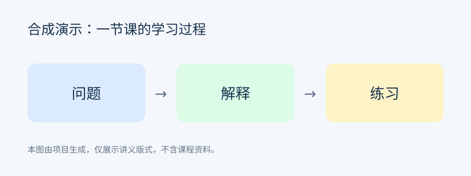

# 示例课程　2026-09-14　第1-2节

> 合成演示，不来自真实课堂。正式产物保留字幕、画面、OCR 和原视频时间。

## 视频 00:05:00

**画面文字（OCR 示例）**：问题 → 解释 → 练习。

[00:05:02] 先提出一个问题，再解释思路，最后用练习检查理解。

[00:05:12] 正式讲义中的时间仍与原视频对应，提前结束或跳过长静音不会平移时间戳。

## 按段阅读

正式目录中的 `lecture_parts/INDEX.md` 每十分钟提供一个阅读段，带入上一段末张画面，便于逐段交给 AI 阅读。
